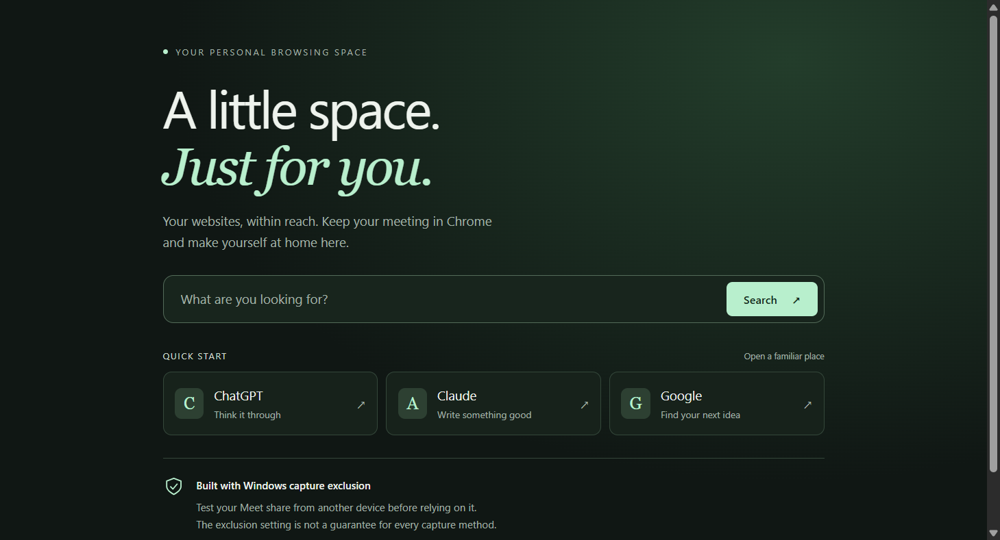

<div align="center">

# Gost Browser

**Your workspace. Your screen. Your choice of what to share.**

A privacy-focused Windows browser for keeping personal web apps out of supported screen captures while you share your screen.

   [](https://github.com/Hassani0x/GostBrowser/actions/workflows/ci.yml)

[Download for Windows](../../releases/latest) · [User guide](docs/USER_GUIDE.md) · [Compatibility matrix](docs/COMPATIBILITY.md) · [Report a bug](../../issues) · [Contribute](CONTRIBUTING.md)

</div>

## Share your presentation. Keep your personal tabs to yourself.

Keep Google Meet in Chrome. Open your notes, reference pages, or favorite web apps in Gost Browser. Gost enables Windows capture exclusion before showing its window, so compatible screen-sharing tools can leave it out of the shared picture.

> **Windows 11 preview:** capture exclusion depends on the recording or sharing software. Verify the received video from a second device before relying on it. This is not a universal invisibility guarantee.



### See the workflow

1. Keep your meeting in Chrome, Teams, Zoom, or another capture app.
2. Open personal notes or reference pages in Gost.
3. Share your screen and verify the receiver-side result from a second device.

Gost is intentionally honest about the boundary: Windows and the capture application decide whether content protection is honored. The [compatibility matrix](docs/COMPATIBILITY.md) tracks reproducible results instead of promising universal invisibility.

If you test Gost with a recorder or meeting app, please [submit a compatibility report](.github/ISSUE_TEMPLATE/compatibility-report.yml). Safe, receiver-side evidence helps the project more than unverified claims.

### Why Gost?

Gost is for people who need a private web workspace during a presentation, interview, demo, lesson, or live support session. It keeps personal tabs separate from the meeting browser and exposes the Windows capture-protection status instead of making an absolute invisibility claim.

**Useful search terms:** Windows privacy browser, screen-sharing privacy, Electron capture exclusion, Windows display affinity, private browser workspace, presentation browser, protected screenshots.

## Features

| Feature | What you get |
| --- | --- |
| Personal web workspace | Tabs, navigation, search, quick links, and persistent website sessions separate from Chrome. |
| Capture exclusion | Windows capture protection enabled on the browser and screenshot selection overlay. |
| Area screenshots | Capture a rectangle from your desktop, another browser, or another app, then paste the PNG. |
| Microphone permissions | Allow a website for the current session, block requests, or revoke access. |
| Quick hide and recovery | Global show/hide shortcut and system-tray controls, with no taskbar entry. |
| Sandboxed web pages | Remote pages run without Node.js or direct app-control access. |

## Get started

1. Download **Gost-Browser-0.3.1-Windows.exe** from [Releases](../../releases/latest).
2. Run the portable application on **Windows 11 x64**. No installer or administrator access is required. This preview is unsigned.
3. Open a website in Gost. Keep your meeting in Chrome or your usual meeting app.
4. Before sharing anything private, [check what a second participant actually sees](docs/USER_GUIDE.md#verify-your-google-meet-setup).

Cookies and sign-ins stay in Gost's own local profile. Existing Chrome sessions are not imported. Website sign-in restrictions can still apply.

### Capture → select → paste

Press **Ctrl+Shift+S**, drag a rectangle, then click your destination field and press **Ctrl+V**. You can also use the camera and Paste buttons in Gost.

- Capture works on the monitor containing your pointer, including other apps and the desktop.
- **Esc** cancels; **Enter** captures the whole selected monitor.
- Screenshots are copied to the clipboard, not automatically saved or uploaded. Clipboard history or sync may retain them if enabled.
- A selection cannot span monitors in this preview. Capture-protected content from other apps may be absent or blank.

### Controls

| Shortcut | Action |
| --- | --- |
| Ctrl+Shift+Space | Show or hide Gost, including while another app is focused |
| Ctrl+Shift+S | Capture an area |
| Ctrl+V | Paste a copied image into a compatible field |
| Ctrl+L | Focus the address bar |
| Ctrl+T / Ctrl+W | Open / close a tab |
| Ctrl+Tab / Ctrl+Shift+Tab | Next / previous tab |
| Ctrl+R | Reload |

The tray icon near the Windows clock provides Show, Hide, Capture area, and Quit. Global shortcuts can conflict with other applications; the button or tray menu remains available.

### Website microphone access

Use the website's microphone or voice control, then choose **Allow for this session** in Gost's permission bar. Grants apply to that website origin and reset on exit. **Mic allowed · Reset** revokes access and reloads tabs for that origin to stop existing audio tracks.

## Know the boundaries

Gost uses Electron's `setContentProtection(true)`, backed by Windows display affinity. The status indicator confirms that the setting is enabled; it does not confirm Google Meet's received video.

Screen exclusion does not hide shared audio, the shared cursor, operating-system dialogs, the tray icon, process lists, or the physical screen. File pickers are outside Gost's protection. Test each monitor and capture mode again after updates.

This preview supports websites and web apps, not arbitrary native Windows programs. Camera, website screen capture, downloads, notifications, and location permissions are disabled. There are no browser extensions, password manager, or automatic updates. Some embedded-browser sign-ins and popup-dependent authentication flows may fail. Windows may refuse pin-on-top while taskbar hiding is enabled; Gost reports that failure.

## Run from source

Use Windows 11 x64 with Node.js 24 LTS and npm:

```powershell
git clone https://github.com/Hassani0x/GostBrowser.git
cd GostBrowser
npm.cmd ci
npm.cmd start
```

Build a portable Windows executable:

```powershell
npm.cmd run dist
```

The output is written to `release/`.

## Development and verification

```powershell
npm.cmd test
npm.cmd run test:app
npm.cmd run test:screenshot
```

Unit checks cover navigation, microphone policy, and screenshot geometry. Electron checks exercise sandboxing, permissions, controls, native display affinity, and screenshot selection. A controlled real-screen/clipboard pixel comparison is available with:

```powershell
node node_modules/electron/cli.js tests/capture-roundtrip.js
```

Desktop checks open windows and may temporarily replace and restore clipboard contents. Run them outside a live meeting. Automated results do not replace participant-side Meet verification, physical microphone testing, or account sign-in testing. See the [full guide](docs/USER_GUIDE.md) for test scope.

## Help shape Gost

Reproducible bug reports, accessibility improvements, multi-monitor testing, and clearer documentation are welcome. Read [CONTRIBUTING.md](CONTRIBUTING.md) and [SECURITY.md](SECURITY.md) before opening an issue. If Gost is useful to you, a star helps others find it.

See [CHANGELOG.md](CHANGELOG.md) for release history.

See [ROADMAP.md](ROADMAP.md) for planned improvements and [docs/COMPATIBILITY.md](docs/COMPATIBILITY.md) for receiver-side testing results.

### Share a real result

The most useful way to help Gost grow is to share a reproducible result: the Windows version, capture application, capture mode, monitor scaling, and what a receiver actually saw. Use the [compatibility report](.github/ISSUE_TEMPLATE/compatibility-report.yml) instead of posting private meeting content or making an unverified claim.

## License

Built by Hussain Agha Hassani.

Released under the [MIT license](LICENSE).
